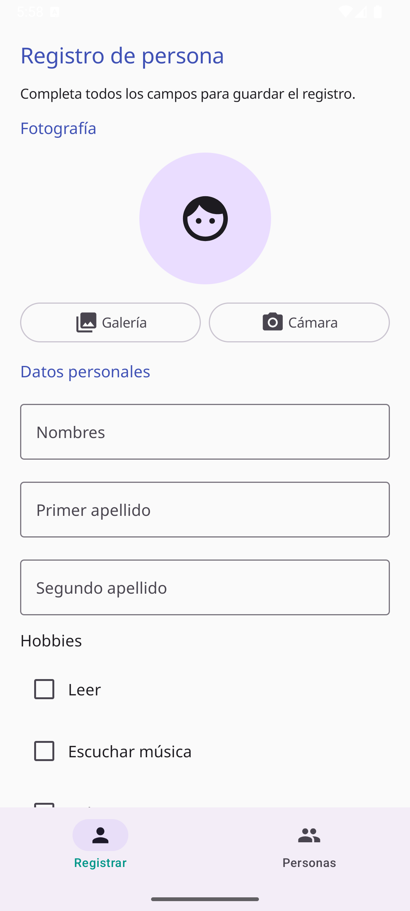
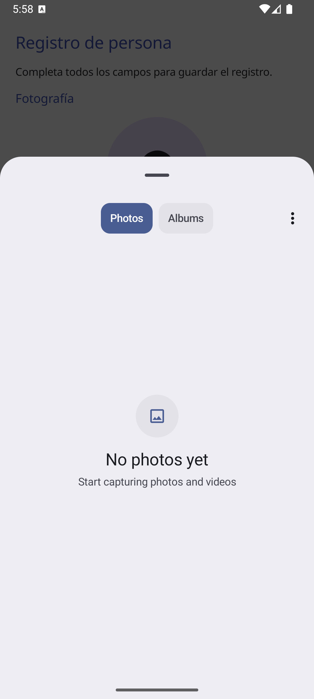
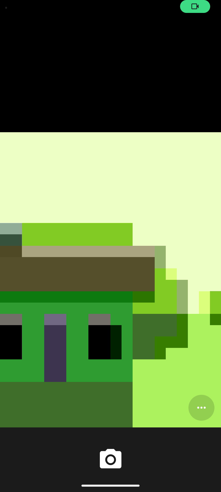
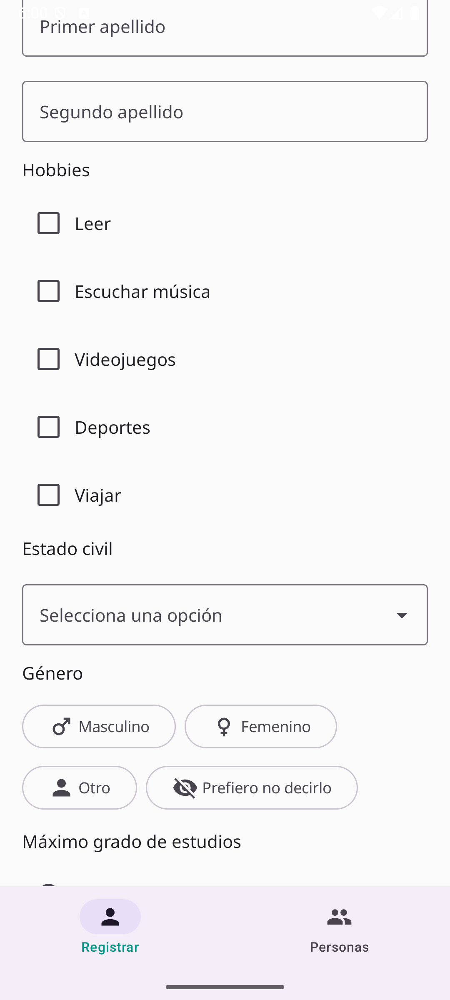
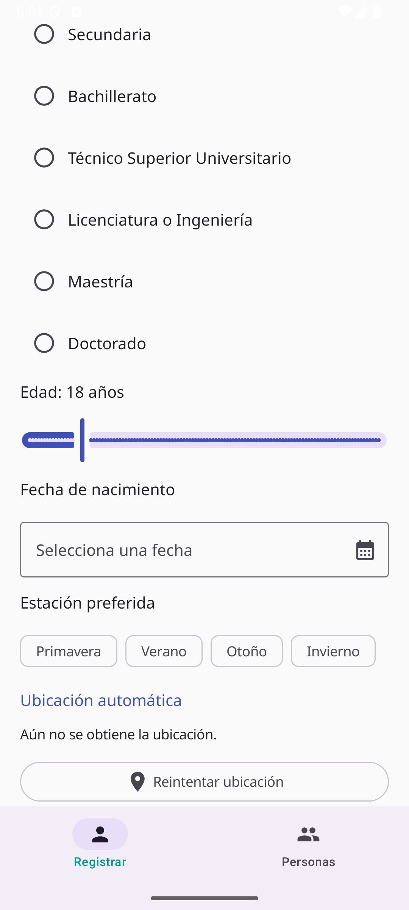
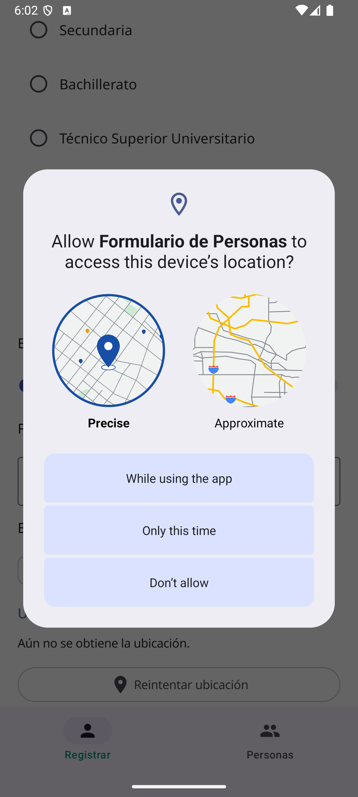
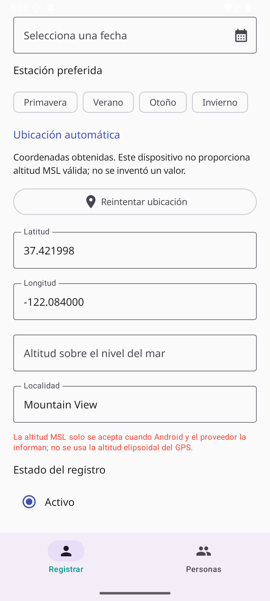
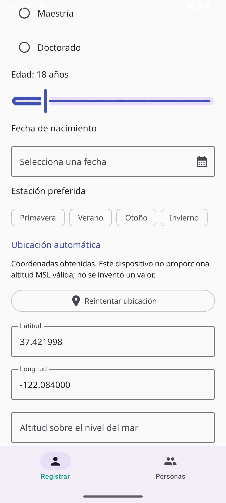

# Práctica: formulario móvil para el registro de personas

## 1. Título de la práctica

Desarrollo de un formulario móvil con Kotlin, Jetpack Compose, Material Design 3 y Supabase.

## 2. Objetivo

Desarrollar una aplicación Android que capture datos personales, preferencias, fotografía y ubicación, y que almacene y consulte los registros en Supabase.

## 3. Introducción

La práctica integra controles declarativos de Jetpack Compose con Material Design 3 y un servicio PostgreSQL en Supabase. También utiliza la cámara y el selector de fotografías de Android, permisos de ubicación en primer plano y geocodificación inversa. La fotografía se conserva en Supabase Storage; PostgreSQL guarda su URL y los demás datos del formulario.

## 4. Herramientas utilizadas

- Kotlin y Android Gradle Plugin.
- Jetpack Compose y Material Design 3.
- Noto Sans.
- Supabase Kotlin, PostgreSQL y Supabase Storage.
- Coil para cargar imágenes remotas en Compose.
- Android Photo Picker, `TakePicture`, `FileProvider`, `LocationManager` y `Geocoder`.
- Android SDK, Gradle Wrapper y Android Studio.

## 5. Descripción del desarrollo

La aplicación presenta dos vistas mediante una barra inferior. **Registrar** contiene los campos personales, hobbies, estado civil, género, estudios, edad, nacimiento, estación, ubicación y estado. **Personas** consulta los registros, los ordena por primer apellido y ofrece un diálogo de detalles de solo lectura.

Los valores del formulario viven en estado Compose. Antes de guardar, se revisan los campos obligatorios, la selección de fotografía y ubicación, y que la edad coincida con la fecha de nacimiento considerando año, mes y día. El envío deshabilita temporalmente el botón y muestra el resultado mediante Snackbar.

## 6. Componentes Material Design 3

- `OutlinedTextField` para nombres, apellidos y ubicación de solo lectura.
- Checkbox para seleccionar uno o varios hobbies.
- Menú desplegable para estado civil.
- Iconos acompañados por etiquetas para la selección de género.
- RadioButton para estudios y estado activo/inactivo.
- Slider entero para la edad entre 0 y 120 años.
- DatePicker para la fecha de nacimiento, bloqueando fechas futuras.
- FilterChip para elegir una estación del año.
- `NavigationBar` para alternar vistas; `Card` y `LazyColumn` para los registros.
- `Snackbar`, `CircleShape` y `RoundedCornerShape` para mensajes e imágenes.

## 7. Sensores y ubicación

La aplicación solicita permisos de ubicación precisa y aproximada al pulsar el botón correspondiente. No solicita ubicación en segundo plano. Android obtiene una ubicación actual usando un proveedor habilitado; después, `Geocoder` busca localidad y utiliza referencias geográficas alternativas cuando es necesario.

La altitud solo se acepta cuando Android 14 o posterior y el proveedor informan explícitamente una altura sobre el nivel medio del mar (MSL). La altitud elipsoidal del GPS no se presenta como MSL. Si falta una localidad o altitud MSL válida, el formulario no permite guardar y ofrece reintentar la ubicación.

## 8. Supabase Storage

Photo Picker concede acceso únicamente a la imagen seleccionada. La cámara utiliza `TakePicture` con una URI temporal compartida mediante `FileProvider`. La aplicación convierte la imagen a JPEG, le asigna un nombre UUID y la sube al bucket `personas-fotos`. El bucket público permite formar la URL que se guarda en PostgreSQL. Si la carga o inserción falla, se intenta eliminar el objeto de la ruta generada.

## 9. Almacenamiento en PostgreSQL

El archivo `documentacion/supabase.sql` crea `personas`, habilita Row Level Security y configura políticas anónimas restringidas a esta tabla y al bucket de la práctica. Los hobbies se almacenan como JSONB; las coordenadas y altitud como `double precision`; la fecha de nacimiento como `date`; la fecha del registro como `timestamptz` con valor predeterminado `now()`; y el estado como booleano.

**Advertencia:** estas políticas públicas son exclusivamente para una demostración académica con datos ficticios. Cualquier cliente público puede leer los registros y subir o eliminar objetos del bucket. No deben utilizarse para datos personales reales. Nunca se incluye una clave `service_role` en la aplicación.

## 10. Resultados

La variante Debug compila con Gradle. El código solicita ordenar los registros por primer apellido y presenta fecha y hora por separado en los detalles. La consulta y el guardado reales aún requieren configuración del proyecto Supabase.

Se instaló la aplicación en el emulador Android 36 (Google APIs, perfil de teléfono) y se capturaron pantallas reales. La ubicación mostrada, Mountain View (`37.421998`, `-122.084000`), es la reportada por el emulador, no por un teléfono físico. El proveedor no informó altitud MSL válida, así que el campo quedó vacío. La URL y clave pública de Supabase no están configuradas; el guardado, Snackbar de éxito, lista con registros, detalles de un registro y capturas de la tabla real siguen pendientes.

### Capturas para el reporte

**Formulario**

**Selección de fotografía**

Selector del sistema, sin fotografías disponibles en el emulador:

Vista de cámara del emulador:

**Componentes de selección**

**Ubicación automática**

La autorización fue concedida en el emulador; esta captura muestra el diálogo de permisos:

Las coordenadas y la localidad siguientes son las devueltas por el entorno virtual. El proveedor no ofreció altitud MSL válida y el campo permanece vacío:

**Snackbar de éxito**

> [Pendiente: configurar URL y clave pública de Supabase y capturar el Snackbar después de guardar un registro de prueba.]

**Lista de personas**

> [Pendiente: configurar Supabase y capturar registros de demostración ordenados por primer apellido.]

**Vista de detalles**

> [Pendiente: configurar Supabase y capturar un registro de demostración en el diálogo de detalles.]

**Tabla y almacenamiento en Supabase**

> [Pendiente: ejecutar `documentacion/supabase.sql` en el proyecto académico y agregar capturas reales de la tabla `personas` y el bucket `personas-fotos`.]

## 11. Conclusiones

La práctica reúne controles de formulario, validaciones, fotografía, ubicación y persistencia remota en una aplicación Android de estructura sencilla. Compose permite que la interfaz siga el estado del formulario; Supabase separa los datos estructurados de las imágenes. La configuración anónima debe limitarse a datos de demostración. Antes de usar el sistema con un proyecto, deben agregarse sus credenciales públicas y comprobarse el flujo en un dispositivo con permisos y ubicación disponibles.
